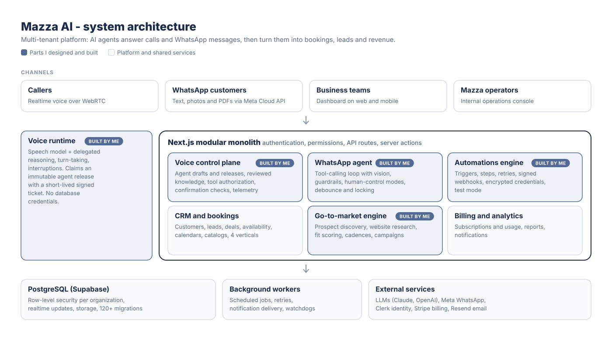

# Mazza AI

**AI voice and WhatsApp agents that answer, qualify and book customers 24/7 for UAE service businesses.**

Built in Dubai. I am the co-founder and CEO, and I built the voice agent, the WhatsApp agent, the automations engine and the go-to-market system described below.

[Website](https://mazzaai.com) · [Architecture](#architecture) · [What I built](#what-i-built) · [Research directions](#research-directions)

> **About this repository.** Mazza AI is a commercial product, so its source code is private. This repository is a technical case study: what the system does, how it is designed, and what I learned building it. **Full source code is available to admissions committees and reviewers on request.**

---

## The problem

Car rentals, salons, clinics, event companies and yacht charters in the UAE run on phone calls and WhatsApp. Messages arrive at all hours, in English, Arabic and a mix of both. Small teams miss many of them, and every missed message is a booking that goes to a competitor.

## What Mazza AI does

- **Voice agent:** answers calls, looks up live business data (services, prices, availability, policies), and turns the conversation into a booking request or a qualified lead.
- **WhatsApp agent:** replies to customers on the business's own WhatsApp number, reads photos and PDFs they send, creates, cancels and reschedules bookings, and hands over to a human the moment one is needed.
- **Dashboard:** one multi-tenant workspace where the business sees every call, chat, booking, lead and customer the agents handled, with analytics and automations.

## Architecture

A **modular monolith** (Next.js on Vercel) backed by **Postgres with row-level security** (Supabase) for tenant isolation, **Clerk** for identity and organizations, and a small set of focused providers for voice, messaging, LLMs, email and billing. Background workers handle retries, scheduled jobs and notification delivery.

I chose a monolith on purpose: at this stage one deployable system is easier to secure, test and operate than a set of microservices.

## What I built

| Area | Highlights | Write-up |
| --- | --- | --- |
| **Voice agent** | Three generations: a managed voice platform, then my own realtime pipeline (speech-to-text, end-of-turn detection, LLM, text-to-speech), then a native speech-to-speech model with delegated reasoning. Speculative generation, prompt caching, per-turn latency and cost telemetry, confirmation checks before any booking. | [docs/voice-agent.md](docs/voice-agent.md) |
| **WhatsApp agent** | A tool-calling agent loop with vision, a "core rules vs editable surface" guardrail model, four human-control modes, sub-second webhooks with debounce and locking, and critical alerts to staff when a customer asks for a human. | [docs/whatsapp-agent.md](docs/whatsapp-agent.md) |
| **Automations** | A trigger and step workflow engine with a clear partial-failure model, retries, bounded chains, signed webhooks, encrypted credentials and a safe test mode. | [docs/automations.md](docs/automations.md) |
| **Go-to-market** | An outbound engine: business discovery, website research with deterministic contact extraction plus LLM fit scoring, follow-up cadences, and compliant email campaigns. I also ran cold calling and founder-led sales myself. | [docs/go-to-market.md](docs/go-to-market.md) |

## By the numbers

| | |
| --- | --- |
| API routes | 78 |
| Database migrations | 120+ |
| Automated tests | 300+ on the web platform, 270+ on the voice runtime |
| Business verticals supported | car rental, salon, clinic, events |
| Languages | English, Arabic and mixed English/Arabic |
| CI quality gate | secret and hygiene scan, migration checks, lint, typecheck, tests, dependency audit, production build |

Voice runtime measurements from synthetic browser test calls (not phone lines, and not a production SLA):

| | |
| --- | --- |
| Perceived wait (time until the caller hears a response, p50) | about 225 ms |
| Time to the first word of the real answer (p50) | about 1.9 s |
| Time saved per speculative-generation hit | about 400 to 660 ms |
| Prompt cache hit rate on input tokens | 100% |
| Model and speech cost | about $0.03 per minute |

## Engineering principles

1. **Never claim what you did not verify.** A booking request is not a confirmed booking, a provider acknowledgement is not proof the audio played, and an estimated cost is labelled as an estimate.
2. **Privacy by design.** Mazza does not keep call recordings or full transcripts. Recording and transcript storage are switched off at the provider level on every agent sync, and the app stores only call metadata, a summary, sentiment and a structured outcome.
3. **Every action that changes data is idempotent.** Tool calls carry stable invocation IDs, so a provider retry replays the saved result instead of booking twice.
4. **Humans stay in control.** Escalation cannot be disabled by configuration, the agent always says it is an AI, and staff can take over any conversation instantly.
5. **Test safely.** Every agent has a playground or test lab where actions that would change data are simulated and nothing is sent to real customers.

## Research directions

Building this product raised questions I want to study properly:

- **Speech recognition for Gulf Arabic and English code-switching.** Most commercial speech-to-text models handle English or Modern Standard Arabic, but UAE callers switch languages mid-sentence. I found that several leading models either exclude Arabic from their multilingual mode or need a fixed language. How do we build and evaluate recognition for real Gulf code-switched speech?
- **Turn-taking and backchannels in spoken agents.** When should an agent speak, wait, or say "mm-hmm"? I built a rule-based listener that chooses short acknowledgements from what the caller actually said, which cut inappropriate sounds on a replayed test call from 20 to 0. A learned, bilingual turn-taking model is an open problem.
- **Reliable tool use in live conversation.** Spoken agents must collect details, read them back, get confirmation and only then act, even when the caller interrupts or corrects themselves. How do we measure and guarantee that, rather than trusting the model?
- **Latency vs quality.** Speculative generation and streaming hide latency, but they waste compute when the guess is wrong. What is the right trade-off for real-time agents?

## Code samples

The production code is private, but [samples/](samples/) contains small, tested, standalone versions of problems I solved: exactly-once tool execution for AI agents, debounced single-flight replies for a messaging agent, and phone number normalization.

## Tech stack

TypeScript, Next.js, React, Python, PostgreSQL (Supabase), Clerk, Anthropic Claude and OpenAI models, WebRTC, Meta WhatsApp Cloud API, Stripe, Resend, Docker, Vercel, GitHub Actions.

---

Want to see the code? Reach me through my [GitHub profile](https://github.com/zedan-010) and I will arrange read-only access for reviewers.
